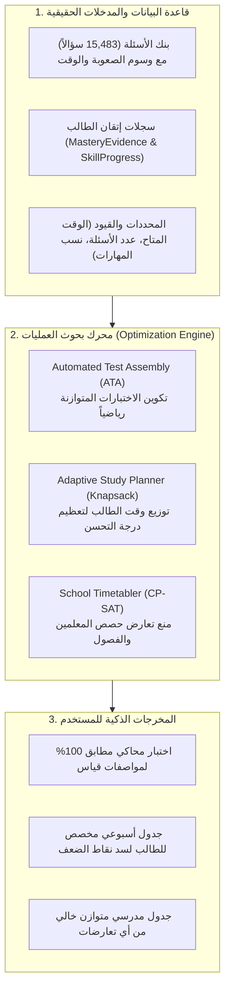

# ADR-0008: دمج بحوث العمليات (Operations Research) للتعلم التكيفي وتكوين الاختبارات والجدولة المدرسية
## Architectural Decision Record: Operations Research & Mathematical Optimization Engine

**التاريخ**: 21 نوفمبر 2026  
**الحالة**: معتمد للتنفيذ المرحلي (Accepted for Phased Implementation)  
**المالك**: منصة المئة (ALMEAA EdTech Architecture)  
**النطاقات المستهدفة**: `internal/assessment`, `internal/learning`, `internal/organizations`  

---

## 1. السياق والمشكلة (Context & Problem Statement)

تعتمد معظم المنصات التعليمية والتقويمية على استعلامات عشوائية أو قواعد ثابتة وبسيطة (Heuristics) لاختيار الأسئلة وتوليد خطط الدراسة، مما يؤدي إلى:
1. **اختبارات غير متوازنة**: اختبارات قد تحتوي على أسئلة مكررة من نفس الفكرة، أو تباين عشوائي في درجات الصعوبة، أو عدم توازن في تمثيل المهارات المعتمدة من المركز الوطني للقياس (قياس).
2. **خطط مذاكرة غير فعالة**: توزيع متساوٍ ساذج لوقت الطالب دون مراعاة وزنه النسبي في الاختبار وفجوات الإتقان الحقيقية.
3. **تعقيد الجدولة المدرسية**: صعوبة توزيع حصص المعلمين وجداول الفصول والتدخلات العلاجية مع تزايد عدد الطلاب إلى الآلاف وتجنب التعارضات الزمانية والمكانية.

---

## 2. القرار المعماري (Architectural Decision)

اعتماد **بحوث العمليات (Operations Research - OR)** ومحركات التحسين الرياضي المقيد (Constraint Programming & Mixed-Integer Linear Programming) كطبقة ذكاء قرار رياضي (Decision Intelligence Layer) مكملة للذكاء الاصطناعي التوليدي، مع دمجها وفق نمط **Modular Monolith** دون الإخلال بـ Stack المنصة الأساسي (Go + PostgreSQL + Redis + React).

---

## 3. مجالات التطبيق الثلاثة في ALMEAA (Core Use Cases)

### أولاً: تجميع وتكوين الاختبارات الآلي (Automated Test Assembly - ATA)
تحويل عملية اختيار الأسئلة من مجرد عشوائية إلى مسألة برمجة خطية مقيدة:
- **دالة الهدف**: $\max \sum_{i} \text{Relevance}(i, \text{Student}) \times \text{Discrimination}(i)$ (تعظيم ملاءمة السؤال وقدرته التمييزية).
- **القيود الصارمة (Hard Constraints)**:
  1. $\sum x_i = N$ (عدد الأسئلة الإجمالي محدد بدقة).
  2. $\sum_{i \in \text{Skill}_k} x_i = C_k$ (تمثيل كل مهارة فرعية بنسبة مئوية محددة بدقة).
  3. $L_{\text{avg}} - \epsilon \le \frac{\sum d_i x_i}{N} \le L_{\text{avg}} + \epsilon$ (متوسط صعوبة الاختبار مضبوط في نطاق قياس المعياري).
  4. منع ظهور أي سؤال تم حله في آخر 30 يوماً.
  5. قيد التجميع (All-or-None): أسئلة القطع القرائية تُجلب كاملة لنفس القطعة أو تُستبعد كاملة.

### ثانياً: تحسين خطة التعلم التكيفي (Adaptive Study Plan - Knapsack Problem)
- طالب لديه وقت محدد أسبوعياً (مثلاً $T = 6$ ساعات).
- **الهدف**: تعظيم القيمة المضافة لدرجات الطالب المتوقعة في الاختبار الحقيقي.
- **القيد**: الوقت المستغرق في دراسة الدروس وحل التدريبات $\le T$.
- **الأولوية**: تركز على المهارات التي تمثل وزناً كبيراً في اختبار قياس والتي يعاني فيها الطالب من فجوة إتقان (Low Mastery Score).

### ثالثاً: الجدولة المدرسية والتدخلات العلاجية (School Timetabling & Interventions)
- استخدام نموذج مطابقة القيود (Constraint Satisfaction Problem - CSP) لتوزيع مجموعات التقوية والتدخلات العلاجية للطلاب المتعثرين على المعلمين المتاحين دون أي تضارب زمني.

---

## 4. التكامل التقني في معمارية المنصة (Technical Implementation Strategy)

### المرحلة 1: محرك داخلي خفيف في Go (Native Go Optimizer)
- يُبنى كحزمة داخلية في `internal/assessment/application/optimizer.go`.
- يحل مسائل تجميع الاختبارات السريعة (Automated Test Assembly) عبر خوارزميات Branch-and-Bound / Heuristic Knapsack سريعة جداً تعمل في زمن استجابة **< 10ms** دون أي استدعاءات خارجية أو إبطاء للسيرفر.

### المرحلة 2: محرك Google OR-Tools عبر Worker منفصل (Async OR Worker)
- للمسائل المعقدة جداً (مثل جدولة مدرسة كاملة تضم 1000 طالب و 50 معلماً، أو تجميع خطة فصل دراسي كامل):
  - تشغيل كود `Google OR-Tools (CP-SAT Solver)` داخل `cmd/worker` أو خدمة مصغرة خفيفة.
  - يستقبل المعطيات والقيود عبر Redis Task Queue، ويقوم المحرك بحساب الحل الرياضي الأمثل ثم تخزينه في جداول PostgreSQL (`study_plans`, `school_interventions`).

---

## 5. خطة التنفيذ المعتمدة (Phased Roadmap)

| الخطوة | التطبيق العملي | النطاق البرمجي | العائد على المنصة |
| :---: | :--- | :--- | :--- |
| **1** | محرك الاختبار المتوازن (Smart Balanced Quiz) | `internal/assessment` | اختبارات ذاتية ومحاكية دقيقة 100% تطابق معايير قياس وتمنع التكرار تماماً |
| **2** | مجدول المذاكرة التكيفي الذكي (Optimal Study Scheduler) | `internal/learning` | خطة دراسة واقعية تحسب للطالب بالضبط كم دقيقة يقضيها في كل مهارة حسب وقته الفعلي |
| **3** | جدولة الفصول والتدخلات المدرسية (School Interventions Matching) | `internal/organizations` | ميزة تنافسية كبرى لمدراء المدارس والمجمعات لإنشاء جداول الدعم بنقرة زر |

---

## 6. قواعد الجودة والأمان (Rules of Engagement)
1. محرك التحسين الرياضي يتخذ قرارات توزيع وجدولة فقط؛ **لا يغير نظام التصحيح الأكاديمي أو حساب درجات الطلاب**.
2. يجب أن يحترم المحرك العزل الصارم للمدارس والصلاحيات (Multi-Tenant Isolation).
3. تغطية المحرك باختبارات وحدة آلية (`optimizer_test.go`) تثبت التزام النتائج بكافة القيود الصارمة (Zero Constraint Violations).
