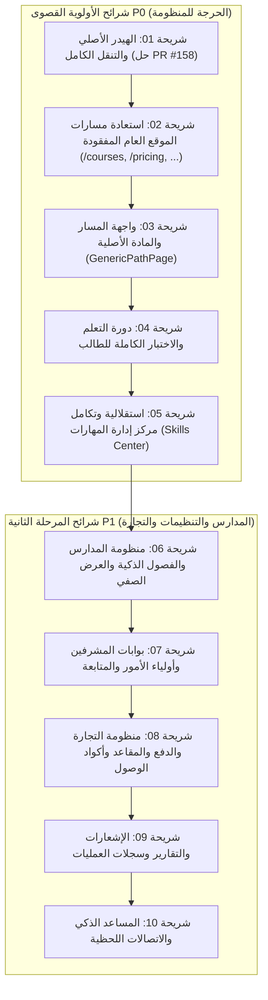

# ALMEAA MIGRATION EXECUTION ROADMAP
## خارطة طريق التنفيذ والتحويل بالشرائح العمودية (Vertical Slices Roadmap)

> **تاريخ الاعتماد:** 30 أكتوبر 2026  
> **حالة الخارطة:** جاهزة للتنفيذ المعتمد بعد اكتمال التدقيق الشامل (Phase 1)  
> **الهدف الهندسي:** إغلاق الفجوات القائمة بين `almeaacodax` و `almeaago` بنسبة تطابق وظيفي وبصري 100% مع الحفاظ على استقرار وكفاءة Go Backend وPostgreSQL.

---

## 1. استراتيجية التنفيذ وقواعد الإغلاق الهندسي

### 1.1 مبدأ الشرائح العمودية الكاملة (Vertical Slices)
يُحظر تماماً أي عمل أفقي مجزأ (مثل تعديل واجهات دون ربط بالخادم، أو كتابة مسارات API دون واجهة مستخدم). كل شريحة عمل يجب أن تكون مكتملة الحلقات:
$$\text{Actor (Role)} \longrightarrow \text{Screen / Interaction} \longrightarrow \text{HTTP Chi Route} \longrightarrow \text{Go Domain Service} \longrightarrow \text{PostgreSQL Storage}$$

### 1.2 قواعد الحوكمة ومنع التكرار (Anti-Drift & Anti-Hallucination)
1. **الالتزام الحرفي بتصميم وسلوك Legacy:** النسخة المعتمدة من `almeaacodax/main` هي المرجع البصري والوظيفي لكافة الشاشات.
2. **منع تعدد الكتاب على نفس الفرع:** لا يعمل وكيلان أو مطوران على نفس الملفات أو نفس الفرع في وقت واحد.
3. **دورة حياة الميزة الصارمة:**
   - إنتاج اختبار أحمر يثبت الفجوة مع الأصل (RED Baseline Test).
   - تنفيذ الإصلاح الهندسي في كود الواجهة أو الـ Go Backend (GREEN Implementation).
   - تشغيل الاختبارات المدمجة والتأكد من اجتياز كافة فحوصات CI الرسمية على GitHub.
   - التحقق البصري المزدوج ومقارنة لقطات الشاشة على المقاسات الثلاثة (390px, 820px, 1440px RTL).
   - الدمج النظيف في فرع `main`.

---

## 2. جدول الأولويات والشرائح العمودية (P0 & P1 Execution Slices)

---

## 3. تفصيل شرائح الأولوية القصوى (P0 Critical Slices)

### الشريحة 01: استعادة الهيدر الأصلي وشبكة التنقل الكاملة (Original Header & Navigation Parity)
- **الأولوية:** P0 (الأعلى إلحاحاً).
- **الهدف:** إغلاق الفجوة المركزية في الهيدر الحالي واستعادة القوائم المنسدلة الهرمية، السلة، الإشعارات، مبدل الثيمات، والبحث السريع.
- **خطة التنفيذ الهندسية:**
  1. معالجة وحل سبب تعثر خطوة `Database CI` في Playwright المعلقة في طلب السحب **PR #158** (`feat/original-header-navigation`).
  2. ضبط محددات السلكتور واختبار مقارنة البكسل عند مقاس 390px (Mobile) لضمان اجتياز الاختبار بنجاح.
  3. التأكد من سلامة روابط القوائم المنسدلة للمسارات والمراحل مع مزود الإعدادات في Go (`/api/v1/content/homepage-settings`).
  4. دمج PR #158 في فرع `main`.
- **معيار القبول:** اجتياز اختبارات `header-brand-live.spec.ts` و `original-header-live.spec.ts` على المقاسات الثلاثة (390, 820, 1440) في CI.

---

### الشريحة 02: استعادة مسارات الموقع العام والزائر المفقودة (Public Discovery & Missing Routes)
- **الأولوية:** P0.
- **الهدف:** القضاء على شاشات الخطأ 404 واستعادة صفحات تصفح الدورات والاختبارات والأسعار والمشتريات.
- **المسارات المستهدفة:**
  - تفعيل مسار تصفح الدورات الكاملة `/courses` ومطابقة بطاقات وفلاتر الدورات مع الأصل (إغلاق مسودة PR #209).
  - تفعيل مسار صفحة بنك الاختبارات والمحاكيات `/quizzes` و `/mock-exams` مع التصنيفات القياسية للقدرات والتحصيلي.
  - استعادة صفحة الأسعار والباقات `/pricing` ومصفوفة مقارنة الميزات مع الأصل.
  - تسجيل مسار سلة المشتريات المستقل `/cart` مع إمكانية إدخال كود الخصم واستعراض الملخص المالي.
  - تسجيل صفحة المقالات والمدونة `/blog`، وصفحة الملف الشخصي `/profile`.
- **معيار القبول:** كل رابط في الهيدر والفوتر يقود إلى صفحة نشطة ومطابقة بنسبة 100% دون أي خطأ 404.

---

### الشريحة 03: واجهة المسار والمادة الأصلية (Unified Path & Subject Workspace)
- **الأولوية:** P0.
- **الهدف:** استبدال صفحة `LearningSpacePage` المبسطة بالصفحة الأصلية الكاملة `GenericPathPage` التي تقدم تجربة المسار الحقيقية.
- **عناصر الشريحة:**
  - استعادة شجرة المواد والمستويات والمهارات الخاصة بكل مسار (مثل مسار القدرات العامة ومسار التحصيلي).
  - إظهار شريط التقدم الفعلي لنسبة إتقان الطالب لكل مادة استناداً إلى جدول `skill_progress` في PostgreSQL.
  - إتاحة رؤية تسجيلات واشتراكات الطلاب داخل مساحة العمل كما في الأصل.
- **معيار القبول:** مطابقة واجهة المسار على 3 مقاسات مع دعم كامل لاتجاه RTL والربط بـ Go.

---

### الشريحة 04: دورة التعلم والاختبار الكاملة للطالب (Student Learning & Practice Journey)
- **الأولوية:** P0.
- **الهدف:** ضمان تجربة سلسة وخالية من العيوب للطالب من بدء المذاكرة حتى مراجعة النتائج.
- **عناصر الشريحة:**
  - مشغل الدروس: حفظ نقطة توقف الفيديو بدقة الثواني في جدول `lesson_video_progress` واستئناف المشاهدة تلقائياً.
  - محاكي الاختبارات: عزل جلسة الاختبار، وحفظ الإجابات أولاً بأول، وإجراء التسليم الذري لمنع ضياع المحاولة.
  - بطاقة النتيجة: مطابقة تصميم شاشة النتائج الأصلية في Legacy مع مصفوفة المهارات ونقاط القوة والضعف وزر مشاركة النتيجة.
  - مراجعة الأسئلة: ضمان ثبات أسئلة المحاولة الأصلية عبر النسخ المعتمدة (`question_versions`) دون تغيير، وإتاحة جلسات المراجعة الموجهة.
  - خطة المذاكرة: المحافظة على مهام اليوم الأخير ومنع البتر الصامت استناداً إلى تحسينات PR #242 و PR #246.
- **معيار القبول:** سيناريو E2E كامل للطالب يمر بجميع الخطوات بنجاح مع تأكيد حفظ البيانات في PostgreSQL.

---

### الشريحة 05: استقلالية وتكامل مركز إدارة المهارات (Independent Skills Center)
- **الأولوية:** P0 (امتثال حاسم للقاعدة الثابتة 2).
- **الهدف:** ترسيخ استقلالية مركز المهارات في لوحة الإدارة (`/admin-dashboard?tab=skills` و `SkillsAdminPage.tsx`) ومنع أي خلط بينه وبين إدارة المسارات.
- **عناصر الشريحة:**
  - الحفاظ على التسلسل الإداري المرجعي: (المسارات ➔ المهارات ➔ الأسئلة ➔ الدروس ➔ الدورات).
  - تثبيت التحسينات المدمجة في PR #251 لإصلاح محدد ربط الدروس الأصلي وإزالة أي عناصر تحكم غير أصلية.
  - ربط المهارات الفرعية وتوزيع الأسئلة عليها من بنك الأسئلة دون قيود حصرية تكسر التكامل.
- **معيار القبول:** استقلال كامل للشاشة، وتأكيد عمل جميع نوافذ الإضافة والتعديل والربط مع PostgreSQL.

---

## 4. تفصيل شرائح المرحلة الثانية (P1 Comprehensive Slices)

### الشريحة 06: منظومة المدارس والفصول الذكية (Schools & Classroom Ecosystem)
- مصفوفة الفصول الـ 12 لمدير المدرسة، والبحث الحرفي في سجل الطلاب (`fix(schools): match Legacy literal school roster search` - PR #212).
- تسلسل عمليات نقل الطلاب بين الفصول لمنع التعارضات التزامنية (`SELECT ... FOR UPDATE` - PR #220).
- شاشة المعلم المجمعة وتثبيت التبويبات الأصلية (إغلاق PR #243).
- عزل شاشة العرض الصفي التفاعلية للبروجكتور وفصل الجلسات المنتهية فوراً (PR #248).

### الشريحة 07: بوابات المشرفين وأولياء الأمور (Supervisors & Parents Portals)
- بوابة المشرف: استعراض إحصائيات المدارس، مؤشرات الأداء، وتوزيع التدخلات الأكاديمية.
- بوابة ولي الأمر: ربط حسابات الأبناء بالرقم القومي أو رمز الحساب، ومتابعة الدرجات والتقارير الموثقة وإزالة الروابط المضافة بغير طلب (PR #252).

### الشريحة 08: منظومة التجارة والمدفوعات والمقاعد (Commerce & Revenue Ledger)
- تكامل بوابة الدفع Tap للدفع بالبطاقات ومدى وApple Pay.
- معالجة أحداث الـ Webhooks مع التحقق من صحة التوقيع الأمني ومنع الدفع المزدوج عبر الـ Idempotency Keys.
- إدارة مقاعد المدارس (B2B Seats) وتوليد أكواد الوصول واستبدالها آلياً.

### الشريحة 09: الإشعارات المركزية والعمليات (Notifications & Audit Logs)
- قوالب الإشعارات الفورية (البريد، واتساب، والإشعارات الميدانية داخل المنصة).
- لوحة مراقبة نشاط النظام وسجلات التدقيق الإدارية (Audit Logs) لتتبع كافة التعديلات الحساسة.

### الشريحة 10: المساعد الذكي والاتصالات اللحظية (AI Tutor & Realtime)
- المساعد الذكي في حل الأسئلة وتوليد الشروحات التعليمية خطوة بخطوة.
- تفعيل الكاش الذكي للإجابات السابقة للحد من التكاليف ومنع تكرار استدعاءات النماذج.
- تأمين اتصالات الـ WebSockets لحصص الفصول التفاعلية عبر خادم Redis.

---

## 5. مصفوفة بوابات الجودة ومعايير القبول (Quality Gates Checklist)

قبل طلب دمج أي شريحة في فرع `main`، يجب توفر الأدلة الهندسية الأربعة التالية:
1. **فحص الأنواع وتجميع الكود (Build Gate):**
   - نجاح تجميع Go: `go build -o api.exe ./cmd/api` بدون تحذيرات.
   - نجاح فحص TypeScript: `npm run typecheck` يعيد 0 أخطاء.
2. **فحص الاختبارات الآلية (Test Gate):**
   - نجاح كافة اختبارات Go ذات الصلة: `go test -v ./internal/...`.
   - نجاح اختبارات Playwright E2E المخصصة للشريحة محلياً وفي GitHub Actions CI.
3. **فحص قاعدة البيانات (Database Integrity Gate):**
   - لا توجد عمليات هجرة مفقودة أو غير متوافقة.
   - وجود قيود المفاتيح الأجنبية وتوثيق المعاملات التزامنية.
4. **فحص التطابق البصري (Visual Parity Gate):**
   - التقاط لقطات شاشة للشاشة على مقاس 390px (Mobile) و 820px (Tablet) و 1440px (Desktop) بالاتجاه العربي RTL ومقارنتها مع نظيرتها في `almeaacodax`.
   - التأكد من عدم تغيير الخطوط أو الألوان أو ترتيب القوائم عما كان عليه في Legacy.
