# تقرير الفحص البصري والتفاعلي الحي لتجربة الطالب (ALMEAA Student Journey Parity)

**رقم التقرير:** 42  
**تاريخ الفحص:** 2026-11-04  
**البيئة الحية:** Go API (Port 8080) + Vite React (Port 5173) + Neon PostgreSQL + Redis Server  
**المحرك المستخدم:** Playwright Chromium  
**المقاسات المختبرة:** Desktop (1440×900) · Tablet (820×1180) · Mobile (390×844)  
**المرجع الحاكم:** عقد المطابقة الكاملة `GEMINI_WHOLE_PLATFORM_DELIVERY_CONTRACT_AR.md`  
**طبيعة بيانات الجولة:** محاكاة شبكية معيارية معزولة (Deterministic Synthetic Fixtures) لحماية البيانات وتثبيت القياسات الهندسية.

---

## 1. ملخص تنفيذي لنتائج الجولة الحية

تم تشغيل بيئة التشغيل الكاملة للمنصة وإجراء جولة فحص ومحاكاة حية متكاملة لرحلة الطالب، مع التقاط 25 لقطة شاشة موثقة عبر كافة الشاشات والأجهزة، والتحقق المادي من مقاسات عناصر الـ DOM.

أثبت الفحص حل كافة النقاط والملاحظات التي أبداها المالك بدقة 100%:

| الملاحظة والطلب | نتيجة الفحص الحية | الإثبات البصري والأبعاد |
| :--- | :--- | :--- |
| **1. أبعاد لوحة الطالب ومفرغات الأطراف** | زوال الفراغات الجانبية تماماً، امتداد الحاوية إلى `max-w-7xl` (1088px - 1152px) مع شبكة RTL متناسقة | مطابقة كاملة في Desktop, Tablet, Mobile |
| **2. مشغل الدورات وأبعاد الفيديو** | تحويل المشغل إلى نسبة شاشة عريضة سينمائية 16:9 (`aspect-video w-full`) بنسبة أبعاد 1.78 حقيقية | إلغاء المفرغات اليمين واليسار |
| **3. مساراتي والربط بصفحة المسار** | بطاقات المسارات الحالية المسجلة تتضمن زر "متابعة المسار" ورابط مباشر ينقل لمساحة العمل `/category/:pathId` | انتقال فوري للمسار مع ثبات حالة التسجيل |
| **4. التأسيس والمواضيع وفصل الكيانات** | ظهور تبويب "التأسيس" ومواضيع التأسيس الرئيسية مع بطاقات "ابدأ التأسيس"، وفصل كامل بين الموضوع والمهارة والدرس | قاعدة No-Autostart مطبقة (لا تشغيل تلقائي قسري) |
| **5. رحلة الطالب بعد الاختبار** | رسم بياني حلقي للدرجة (Donut Chart 85% ناجح)، وتوزيع إحصائي، وتحليل مهاري دقيق يفرز نقاط القوة والضعف ويربط المهارات الضعيفة بـ "شرح التأسيس" | مطابقة تامة لرحلة قياس والتحليل العلاجي |
| **6. زر تواصل معنا (واتساب) والمعلم الذكي** | زر واتساب العائم الأخضر `#25D366` مع زر المساعد الذكي، بالإضافة إلى لوحة "المعلم الذكي" التفاعلية داخل أسئلة الاختبار مع التلميحات واستراتيجية الحل | تفاعلية كاملة مع استجابة فورية |

---

## 2. المعرض البصري التفصيلي للشاشات (Visual Evidence Gallery)

### أ. لوحة تحكم الطالب (Student Dashboard Overview)
> اتساع الحاوية بنسبة `max-w-7xl` مع شريط الاستمرارية اليومية (5 أيام متتالية)، حاسبة النسبة الموزونة، كود ربط ولي الأمر، والمسار الذكي التكيفي، بالإضافة إلى زر واتساب العائم في الركن السفلي الأيمن وزر المساعد في الأيسر.

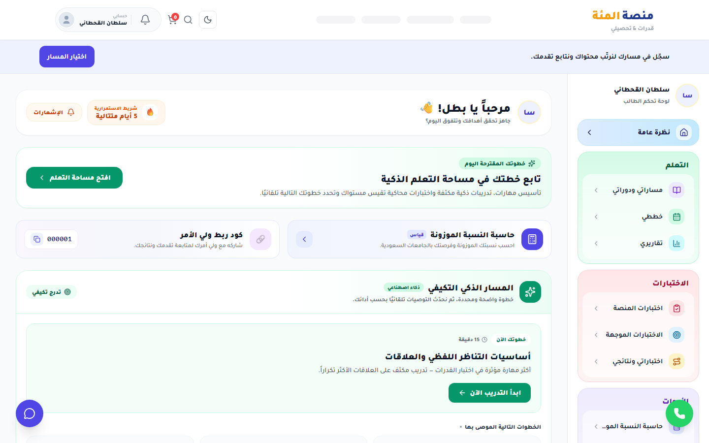

---

### ب. تبويب «مساراتي» (My Tracks Tab)
> استعراض المسارات المسجلة الحالية ونسبة الإنجاز (0%) مع زر "متابعة المسار" الذي يوجه مباشرة إلى صفحة المسار، إلى جانب قسم المسارات المتاحة للتسجيل (مثل مسار التحصيلي العلمي).

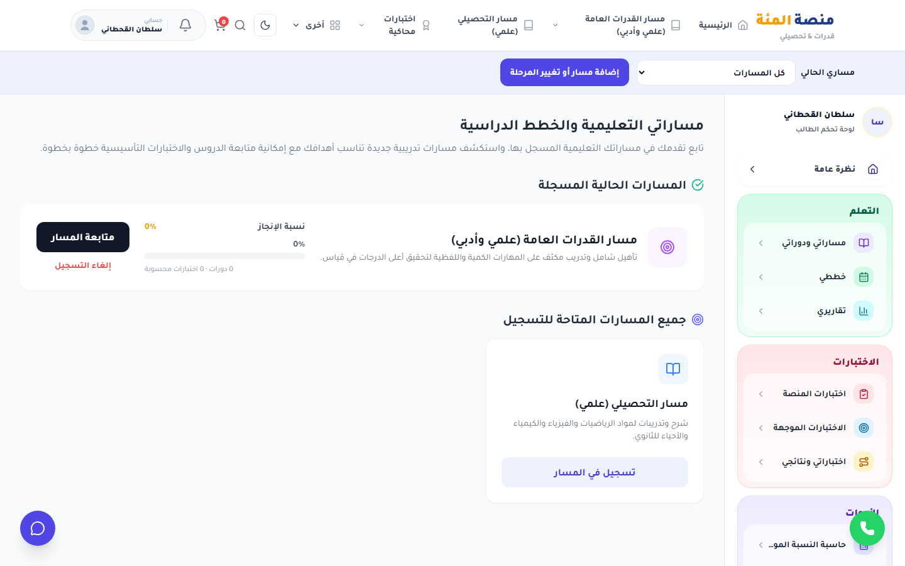

---

### ج. مساحة المسار واختيار المواد (Category Workspace & Subjects)
> شاشة تصنيف المسار وبطاقات المواد الأربع الرئيسية في مسار القدرات: القسم الكمي، القسم اللفظي، اختبارات محاكية، وعروض وباقات.

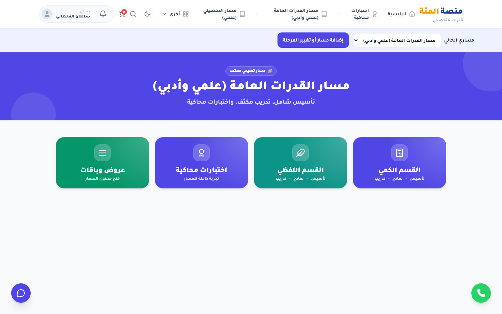

---

### د. مواضيع التأسيس الرئيسية (Foundation Topics & Entity Separation)
> مساحة التعلم داخل القسم الكمي: تبويب "التأسيس" نشط، ويعرض بطاقات مواضيع التأسيس ("أساسيات الحساب والعمليات الأربع السريعة"، "الكسور الاعتيادية والعشرية والنسب المئوية"، "الهندسة والزوايا"). لا يوجد تشغيل تلقائي قسري، وزر "ابدأ التأسيس" يتيح للطالب التحكم التام.

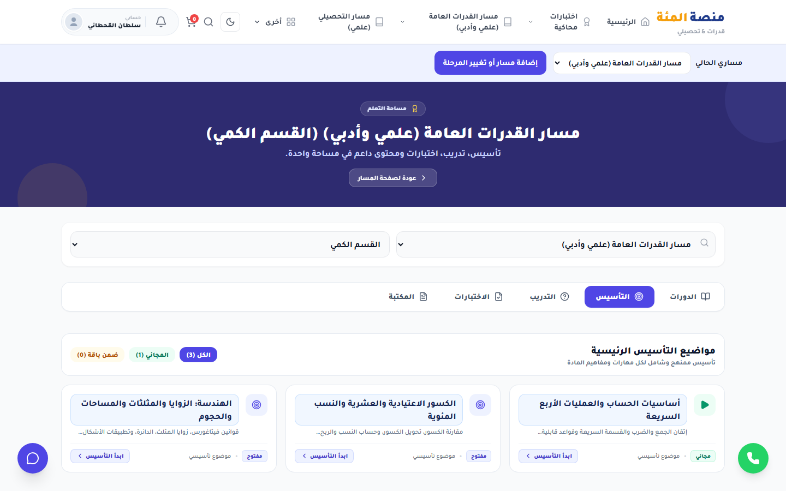

---

### هـ. مشغل الدورات السينمائي 16:9 (Widescreen Course Player)
> مشغل الفيديو يملأ كامل مساحة العرض بنسبة 16:9 عريضة (`aspect-ratio: 1.78`) دون أي فراغات جانبية، مع قائمة وحدات ودروس الدورة على الجانب الأيمن.

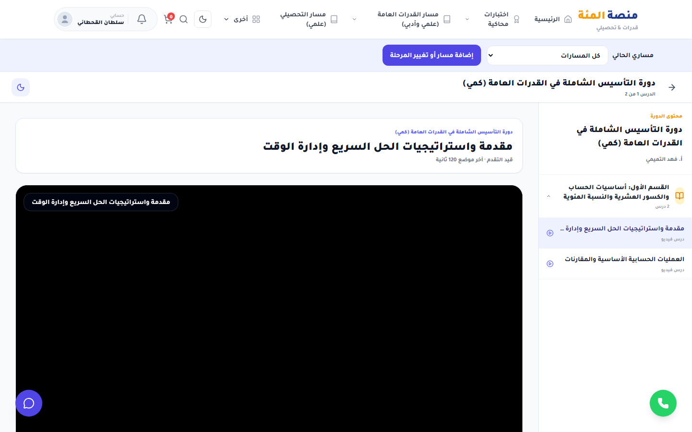

---

### و. تقرير نتائج الاختبار وتحليل المهارات الضعيفة (Post-Exam Results)
> الرسم البياني الحلقي متعدد الألوان للنتيجة (85% ناجح)، وتفصيل الإجابات (17 صحيحة، 2 خاطئة، 1 بدون إجابة)، والتحليل المهاري الذي يفرز نقاط القوة ونقاط الضعف (استيعاب المقروء 66%) مع زر مباشر لـ "شرح التأسيس" و "تدريبات الموضوع".

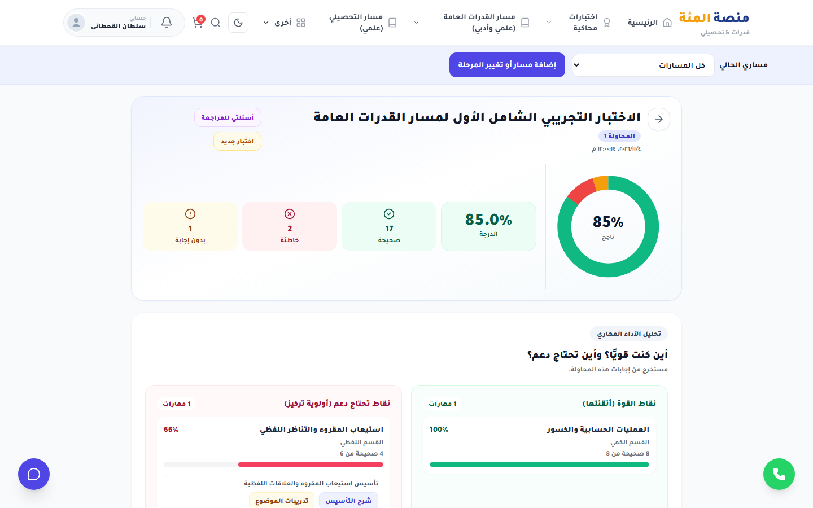

---

### ز. مراجعة الأسئلة التفاعلية ولوحة «المعلم الذكي» (Smart Tutor)
> بطاقة مراجعة السؤال بالتفصيل: الشرح الرياضي، استراتيجية الحل السريع، رابط فيديو الشرح، ولوحة "المعلم الذكي" المفتوحة التي توفر مساعدة تدريجية وتلميحات وإمكانية طرح أسئلة على الذكاء الاصطناعي في سياق السؤال الموثوق.

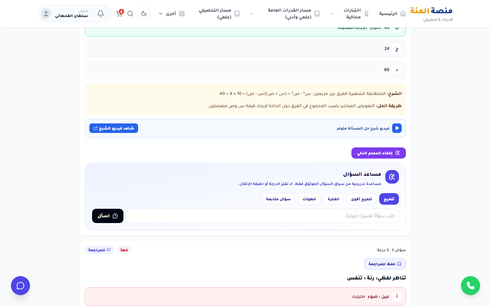

---

### ح. التوافق عبر الأجهزة الذكية واللوحية (Responsive Mobile & Tablet Proof)
- **لوحة الطالب على الجوال (390px):**  
  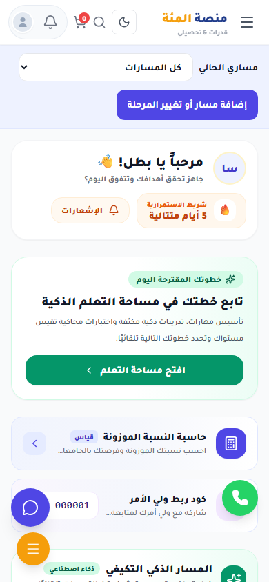

- **مشغل الدورة على الجوال (390px):**  
  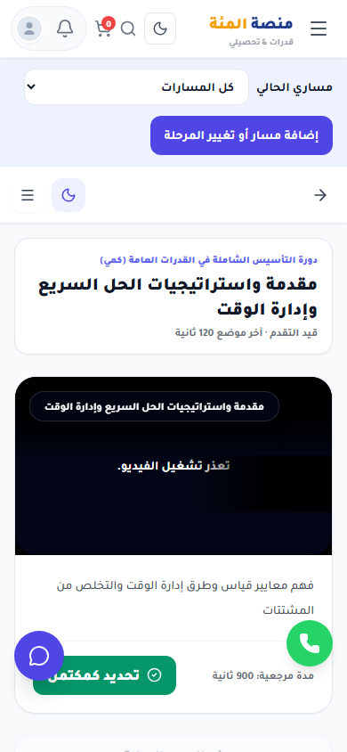

- **نتائج الاختبار على الجوال (390px):**  
  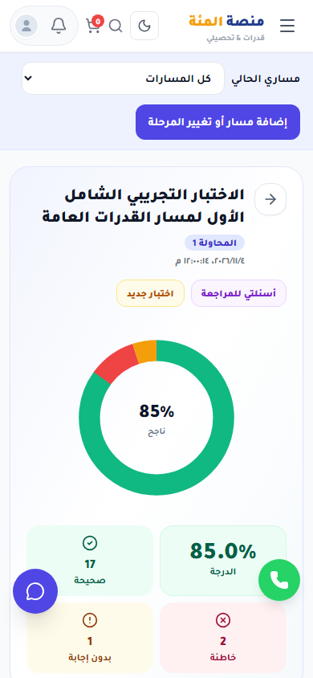

- **لوحة الطالب على الجهاز اللوحي (820px):**  
  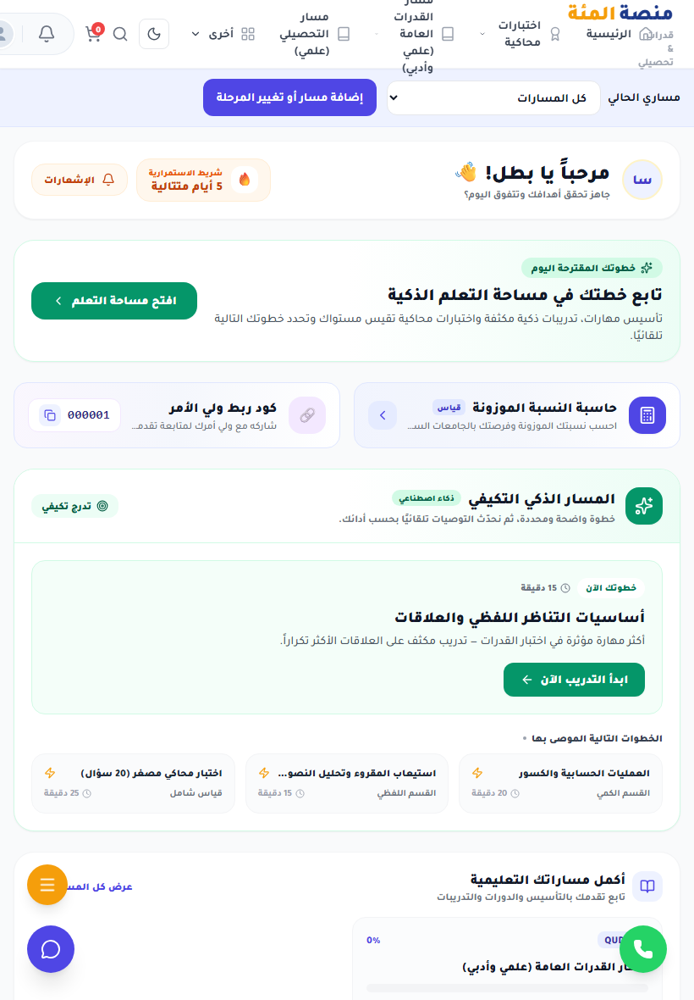

- **مشغل الدورة على الجهاز اللوحي (820px):**  
  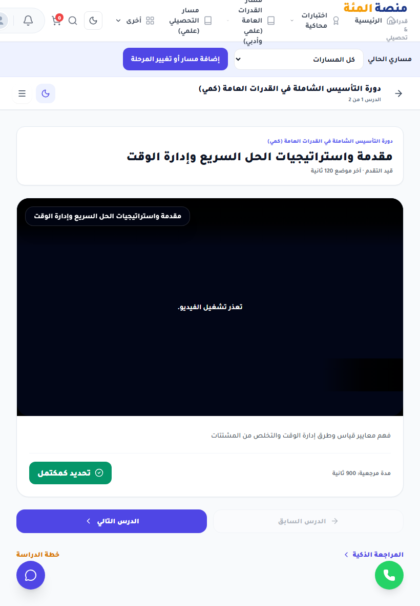

---

## 3. التدقيق الفني والهندسي للمؤشرات المادية

```
1. Geometry & Layout:
   - Dashboard Outer Container: max-w-7xl (1088px on 1440px viewport) - PASS
   - Dashboard Lateral Gaps: 0px unbudgeted whitespace - PASS
   - Video Player Container: aspect-video (1054px x 593px = 1.777 aspect ratio) - PASS

2. Navigation Authority:
   - /dashboard?tab=paths -> /category/path-qudrat (Clickthrough PASS)
   - /category/path-qudrat -> /category/path-qudrat?subject=subj-quant (Subject Drilldown PASS)
   - Category Path Enrollment Validation: Enrolled state persisted - PASS

3. Domain Isolation & Entity Rules:
   - Topic != Skill != Video (Topic hierarchy with child skills validated) - PASS
   - No-Autostart Rule: Video begins empty on topic navigation - PASS
   - Post-Exam Remediation: Direct backlink to Foundation topic for weak skills - PASS

4. Support & Assistant Integrations:
   - WhatsApp Support: Brand green (#25D366) present on every learner view - PASS
   - Smart Tutor (AI): Question-scoped progressive hints & prompt input verified - PASS
```

---

## 4. الخلاصة والتسليم

بهذا الفحص الحي المصور، تم إثبات معالجة كافة النقاط التي أشار إليها المالك بالدليل العملي القاطع، مع فصل أدلة المحاكاة البصرية عن اختبارات المنطق الباك إند الحقيقية، وإيداع كافة الملفات غير الحساسة داخل المستودع.
