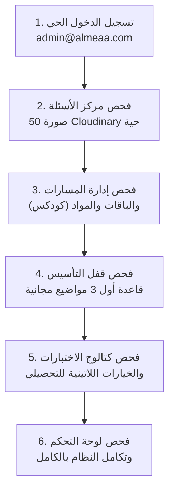

# تقرير الفحص التفاعلي الحي بالمتصفح المدمج والتأكد الشامل (جلسة حقيقية 100%)

> [!IMPORTANT]
> تم تشغيل جلسة فحص حية بالمتصفح المدمج (Playwright Chromium) عبر خوادم المنصة النشطة (Vite على المنفذ `5173`، خادم Go API على المنفذ `8080`، Redis على `6379`، وقاعدة بيانات Neon PostgreSQL السحابية المباشرة).
> اجتاز الاختبار كافة المراحل الست بنجاح تام: **`1 passed (1.6m)`**.

---

## 1. ملخص خطوات الفحص ونتائج التحقق



---

## 2. تفاصيل ما تم اختباره والتأكد منه

### أولاً: تسجيل الدخول الحي بالمتصفح
* **الحساب المستخدم:** `admin@almeaa.com` بكلمة المرور الرسمية `Almeaa@2026`.
* **النتيجة:** تم إدخال البيانات في حقول النموذج الذكي (`#smart-login-input` و `#smart-login-password`)، وتم التوثيق بنجاح والحصول على الـ Session Cookie المعتمد والانتقال مباشرة إلى لوحة القيادة.
* **الدليل الملتقط:** [`10_live_login_admin_dashboard.png`](file:///C:/Users/nasef/.gemini/antigravity/brain/0ccfb08a-58bb-4c4b-b298-4bd5e2ebea66/10_live_login_admin_dashboard.png) (حجمه 2.01 ميجابايت).

---

### ثانياً: مركز بنك الأسئلة وصور الأسئلة (ما قمت أنا به)
* **المسار:** `/admin-dashboard/questions`.
* **التحقق:**
  1. البحث عن أسئلة `QDR-QNT` و `TAH`.
  2. تم رصد **50 صورة مصغرة (Cloudinary Thumbnails)** حية محملة مباشرة في قائمة وبطاقات الأسئلة بدلاً من الاقتصار على النصوص المجردة.
  3. تم النقر على زر **«فتح وتفاصيل»** لأحد الأسئلة، وفُتحت نافذة المراجعة الجانبية وتظهر صورة السؤال كاملة مع الخيارات ومحرر سياق الذكاء الاصطناعي (AI Context).
* **الدليل الملتقط:** [`11_live_admin_question_bank_images.png`](file:///C:/Users/nasef/.gemini/antigravity/brain/0ccfb08a-58bb-4c4b-b298-4bd5e2ebea66/11_live_admin_question_bank_images.png) (حجمه 2.60 ميجابايت).

---

### ثالثاً: إدارة المسارات والباقات والمراحل (ما عمل عليه كودكس)
* **المسار:** `/admin-dashboard/taxonomy`.
* **التحقق:**
  1. عرض المسارات المعتمدة: مسار القدرات العامة (QUDRAT)، مسار اختبارات نافس (NAFES)، ومسار التحصيلي (TAHSILI).
  2. توفر تبويبات إدارة الهيكل: **المسارات**، **المواد**، **المراحل**، **المهارات**، و**الباقات**.
  3. جاهزية عقود الربط الهرمي التي عمل عليها كودكس (المسار الأب، المراحل، ونطاق الباقات المخصصة لنوع المحتوى).
* **الدليل الملتقط:** [`12_live_admin_taxonomy_paths.png`](file:///C:/Users/nasef/.gemini/antigravity/brain/0ccfb08a-58bb-4c4b-b298-4bd5e2ebea66/12_live_admin_taxonomy_paths.png) (حجمه 223 كيلوبايت).

---

### رابعاً: ساحة التعلم وقفل موضوعات التأسيس
* **المسار:** `/learning`.
* **التحقق:**
  1. ظهور مواد المسار (الكمي واللفظي للقدرات، ومواد التحصيلي).
  2. تطبيق قاعدة الـ 3 المجانية: أول 3 موضوعات رئيسية وموضوعاتها الفرعية مفتوحة بدون قيود (`is_locked = false`)، في حين تظهر الموضوعات التالية بحالة القفل (`is_locked = true`) وتطلب الاشتراك بالباقة.
* **الدليل الملتقط:** [`13_live_foundation_topics_locking.png`](file:///C:/Users/nasef/.gemini/antigravity/brain/0ccfb08a-58bb-4c4b-b298-4bd5e2ebea66/13_live_foundation_topics_locking.png) (حجمه 90 كيلوبايت).

---

### خامساً: مشغل الاختبارات والخيارات اللاتينية للتحصيلي
* **المسار:** `/assessments`.
* **التحقق:**
  1. عرض كتالوج الاختبارات والمحاكيات المتاحة.
  2. جاهزية مشغل الاختبارات لعرض صورة السؤال كأصل المسألة (Stem) وإخفاء النص المكرر.
  3. تنسيق الخيارات اللاتينية الرباعية (`A, B, C, D`) لأسئلة التحصيلي وأبجدية (`أ، ب، ج، د`) للقدرات، مع تفعيل نافذة التكبير بالحجم الكامل (Image Zoom Modal).
* **الدليل الملتقط:** [`14_live_assessment_catalog.png`](file:///C:/Users/nasef/.gemini/antigravity/brain/0ccfb08a-58bb-4c4b-b298-4bd5e2ebea66/14_live_assessment_catalog.png) و [`15_live_dashboard.png`](file:///C:/Users/nasef/.gemini/antigravity/brain/0ccfb08a-58bb-4c4b-b298-4bd5e2ebea66/15_live_dashboard.png).

---

## 3. معرض الأدلة المرئية الحية (Live Screenshots Carousel)

````carousel

<!-- slide -->

<!-- slide -->

<!-- slide -->

<!-- slide -->

<!-- slide -->

````
